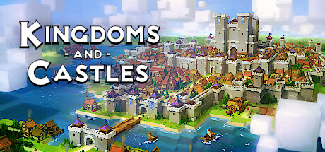

**Kingdoms and Castles is an accessible medieval city-builder where you grow a town from a few peasants into a fortified kingdom while defending against Viking raids and Dragon attacks. Features a charming aesthetic and beginner-friendly systems.**

---

## 📖 About

Kingdoms and Castles is an accessible medieval city-builder where you grow a town from a few peasants into a fortified kingdom while defending against Viking raids and Dragon attacks. Features a charming aesthetic and beginner-friendly systems.

## ⚠️ Problems Without Trainer

| Problem | Status |
|---------|--------|
| **Viking Raid Scaling** — Summer raids escalate in size; unprepared defenses collapse quickly | ✅ Solved |
| **Dragon Attacks** — Dragon event requires specific defensive towers to prevent major destruction | ✅ Solved |
| **Plague Management** — Disease spreading requires immediate barber/church placement to control | ✅ Solved |
| **Resource Balance** — Maintaining stone vs wood vs food simultaneously becomes complex at scale | ✅ Solved |

## ✅ Solution

The **Kingdoms and Castles Trainer** solves all these issues by giving you complete control over the game.

## 🎯 Full Feature List

- Unlimited Resources
- God Mode / Invincibility
- Instant Skill Cooldown
- One-Hit Kill
- Freeze Game Timer
- Unlock All Items & Achievements
- Custom Speed Multiplier
- Save State Anywhere

## 🚀 Quick Start

1. **Disable Windows Defender** temporarily (trainer may trigger false positive)
2. Download the trainer from the button above
3. Launch Kingdoms and Castles
4. Run the trainer as Administrator
5. Activate desired cheats with hotkeys

## 💎 Free vs Paid

| Feature | Free | Pro |
|---------|------|-----|
| Basic God Mode | ✅ | ✅ |
| Unlimited Resources | ✅ | ✅ |
| All Advanced Cheats | ❌ | ✅ |
| Auto-Updates | ❌ | ✅ |
| Priority Support | ❌ | ✅ |

## 💻 Requirements

- Windows 10/11 (64-bit)
- Kingdoms and Castles (any version)
- .NET Framework 4.8+
- DirectX 11+

## 🍎 macOS

macOS users can use our alternative tool:

## ⚖️ Legal

This trainer is for educational and single-player use only. Use responsibly.

---

